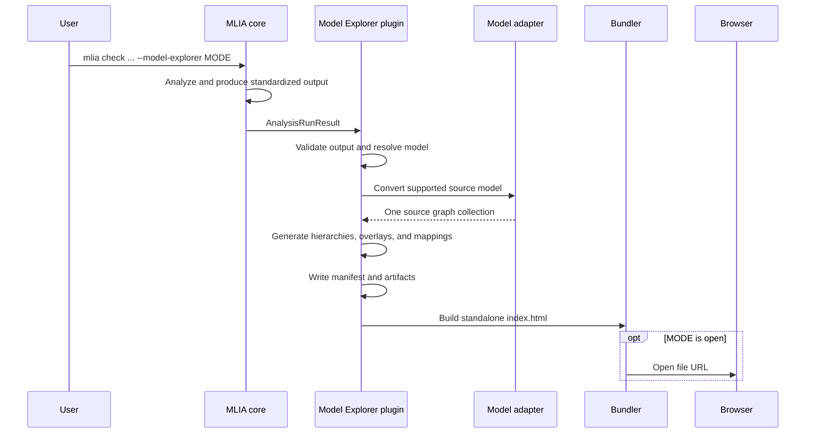

<!---
SPDX-FileCopyrightText: Copyright 2026, Arm Limited and/or its affiliates.
SPDX-License-Identifier: Apache-2.0
--->

# End-to-end Execution Flow

## Command flow

## Artifact generation stages

1. The plugin validates the standardized output and resolves the effective model.
   A command-line model takes precedence. Otherwise, a model materialized in the
   MLIA output root is accepted only when its filename, size when supplied, and
   SHA-256 hash match standardized-output metadata.
2. The matching adapter converts the model to a single source graph collection.
   Format-specific logic maps standardized source-operator IDs to qualified graph
   node references.
3. Each applicable result-local entity-kind hierarchy becomes a generated graph
   collection. Canonical source correspondence is retained while nodes are split
   or grouped into runtime namespaces.
4. Placement, status, metric, check, and advice overlays are associated with
   exact source or generated graph targets. Quantitative totals are not repeated
   across synthetic children when that would imply false per-node values.
5. Sync-navigation and entity-node mappings are produced from the explicit graph
   projections. JSON serialization rejects non-finite numeric values.
6. `manifest.json` records the artifact paths and overlay-to-collection routing.
7. The bundler embeds the referenced graph collections, node data, navigation
   data, host configuration, and vendored JavaScript into one HTML file.

## Empty and missing data

If standardized output is absent when the Python writer is called directly, it
writes a minimal empty result. If no model can be resolved, source conversion is
skipped and MLIA-derived artifacts can still be emitted. If a model is present
but its format or identity mapping is unsupported, generation fails explicitly.

The initial browser view prefers the generated graph with the greatest valid
node-data coverage beside the source graph. If only one graph collection exists,
the right-pane control remains hidden.
