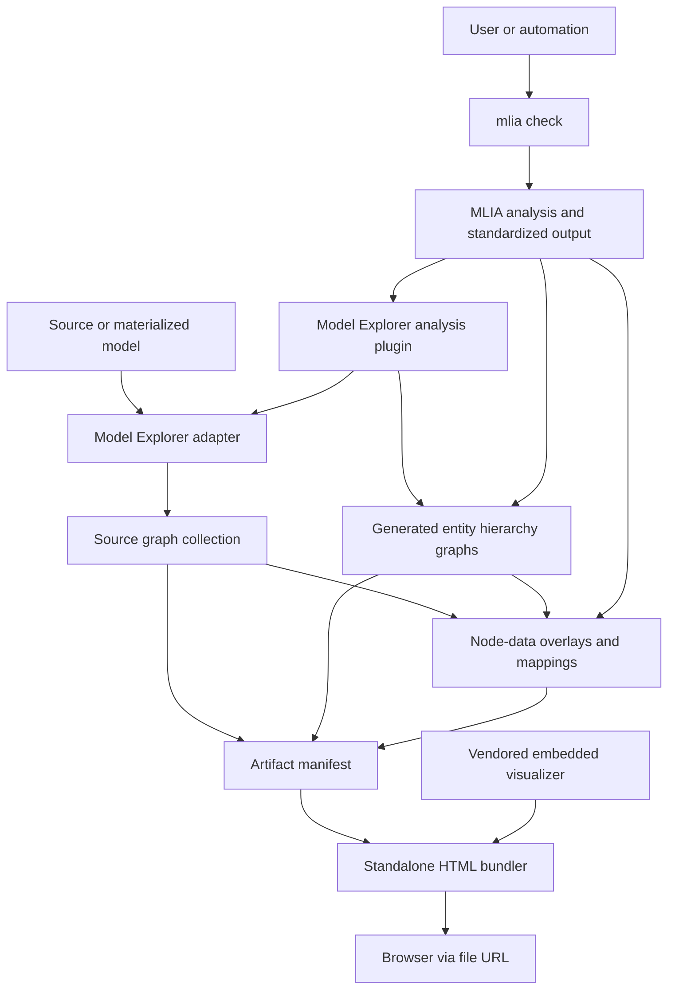

<!---
SPDX-FileCopyrightText: Copyright 2026, Arm Limited and/or its affiliates.
SPDX-License-Identifier: Apache-2.0
--->

# High-level Architecture

The plugin bridges three data models: MLIA standardized output, native Model
Explorer graph collections, and the embedded visualizer's graph and node-data
inputs.

## System view

## Main components

| Component | Responsibility |
| --- | --- |
| Analysis plugin | Registers the CLI option, rejects obsolete plugin settings, validates standardized output, and chooses build or open behavior. |
| Source-model adapter layer | Selects an adapter from the model suffix, normalizes one graph collection, and establishes canonical source-operator node references. |
| Hierarchy graph generation | Discovers result-local entity-kind paths and renders Model Explorer namespace graphs without changing standardized output. |
| Overlay generation | Converts placement, status, metrics, checks, and advice into graph-scoped node data. |
| Navigation generation | Relates source nodes, generated nodes, and MLIA entity IDs with collection-, graph-, and node-qualified references. |
| Bundler | Reads the manifest, embeds every graph and overlay with the visualizer runtime, and selects an initial split view. |

## Identity and scope

A node ID alone is not globally unique. Internal correlations use a tuple of
graph-collection label, graph ID, and node ID. Node-data overlays are also scoped
to the graph collections whose addressable node or namespace keys they match.
This prevents identical graph or node IDs in separate collections from being
treated as the same object.
