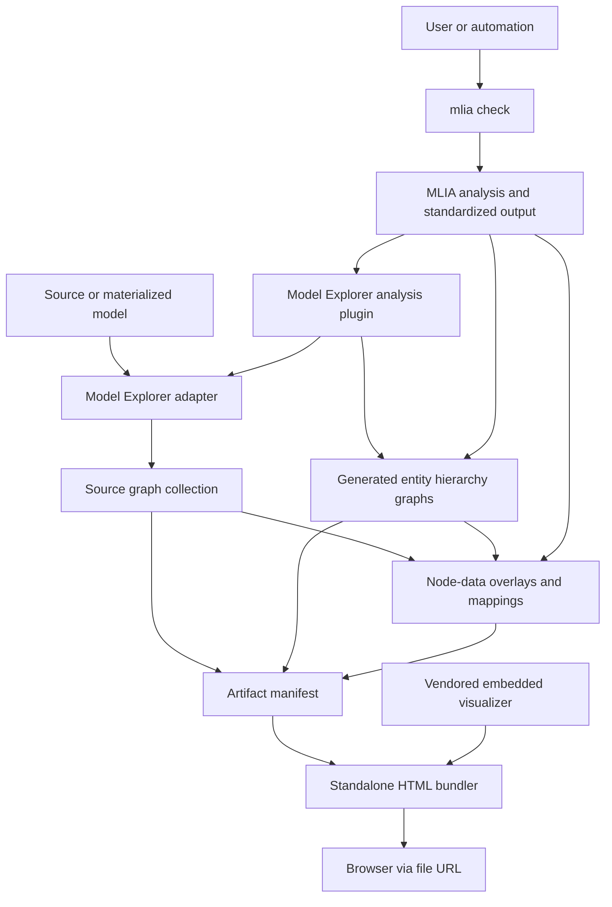

<!---
SPDX-FileCopyrightText: Copyright 2026, Arm Limited and/or its affiliates.
SPDX-License-Identifier: Apache-2.0
--->

# High-level Architecture

The plugin bridges three data models: MLIA standardized output, native Model
Explorer graph collections, and the embedded visualizer's graph and node-data
inputs.

ETRecord uses this same pipeline through a private format integration that owns
source-collection selection, optional companion/compiler views and presentation
policy, including its additional chain mapping view. Shared ExecuTorch artifact
reading and extraction of recorded identities and relationships belong to
`mlia-converters-pytorch`. Neural Technology attributes and aggregates runtime
samples, decodes VGF payloads and publishes compiler relationships. Model
Explorer consumes those standardized results. See
[ETRecord profiling](etrecord.md).

## System view

## Main components

| Component | Responsibility |
| --- | --- |
| Analysis plugin | Registers the CLI option, rejects obsolete plugin settings, validates standardized output, and chooses build or open behavior. |
| Source-model adapter layer | Selects an adapter from the model suffix, normalizes one graph collection, and establishes canonical source-operator node references. |
| Format integration | Supplies format-specific source identity, supplementary graph collections, entity references and presentation settings to the shared writers. |
| Hierarchy graph generation | Discovers result-local entity-kind paths and renders Model Explorer namespace graphs without changing standardized output. |
| Overlay generation | Converts placement, status, metrics, checks, and advice into graph-scoped node data. |
| Navigation generation | Relates source nodes, generated nodes, and MLIA entity IDs with collection-, graph-, and node-qualified references. |
| Bundler | Reads the manifest, embeds every graph and overlay with the visualizer runtime, and selects an initial split view. |

The artifact writer accepts supplementary graph contributions through the same
serialization, metric projection and navigation functions as generated graphs.
The default integration retains the existing layout, aggregation and initial
pane-selection rules. ExecuTorch-specific adapter reference translation,
companion integrity checks and view policy live in `_artifacts/etrecord.py`.
Artifact reading and compiler relationships are produced before presentation,
through core CLI and Python analysis APIs. The bundler consumes an optional graph reference from the manifest;
it does not select views by format-specific display names.

## Identity and scope

A node ID alone is not globally unique. Internal correlations use a tuple of
graph-collection label, graph ID, and node ID. Node-data overlays are also scoped
to the graph collections whose addressable node or namespace keys they match.
This prevents identical graph or node IDs in separate collections from being
treated as the same object.
